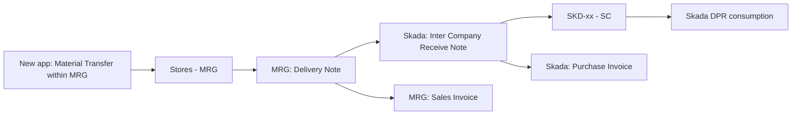

# SOP: Transfer Stock from MRG Store to Skada Site Warehouses

Stock moves **at cost** (valuation rate, no profit) from `Stores - MRG` (company M R G INSULATION WORKS L.L.C) to a Skada site warehouse such as `SKD-46 - SC` (company SKADA CONSTRUCTION L.L.C).

Two companies are involved, so this is never a Material Transfer. Each company records its own side:

| Step | Company | Document | Who |
|---|---|---|---|
| 1 | MRG | Delivery Note to customer `Skada Construction LLC` | MRG Store Keeper |
| 2 | Skada | Inter Company Receive Note (Purchase Receipt) from supplier `MRG INSULATION WORKS LLC` | Skada Store Keeper |
| 3 | MRG | Sales Invoice from the Delivery Note | MRG Accounts |
| 4 | Skada | Purchase Invoice from the Receive Note | Skada Accounts |

Steps 3 and 4 are required. Without them, MRG shows a cost of goods sold with no matching sale, and Skada's "Stock Received But Not Billed" stays open.

---

## 1. One-time setup (Accounts Manager, Desk)

Do this once per site (prod and staging). Skip anything that is already set.

1. **Price List.** Create **Inter Company Transfer** under Selling > Price List: currency AED, with **Buying** and **Selling** both ticked.
   - The Delivery Note's price list must have both boxes ticked. Otherwise "Create > Inter Company Purchase Receipt" fails with *"Selected Price List should have buying and selling fields checked."*
2. **Customer `Skada Construction LLC`** (used in MRG):
   - Is Internal Customer: ticked
   - Represents Company: `SKADA CONSTRUCTION L.L.C`
   - Allowed To Transact With: `M R G INSULATION WORKS L.L.C`
   - Default Price List: `Inter Company Transfer`
3. **Supplier `MRG INSULATION WORKS LLC`** (used in Skada):
   - Is Internal Supplier: ticked
   - Represents Company: `M R G INSULATION WORKS L.L.C`
   - Allowed To Transact With: `SKADA CONSTRUCTION L.L.C`
   - Keep only one internal MRG supplier. The others (`MRG INSULATION WORKS L.L.C`, `MRG INSULATION WORKS L.L.C.`, `MRG INSULATIONN WORKS L.L.C`) must stay non-internal; disable them once they have no open documents.
4. **Skada site warehouses.** Each `SKD-xx - SC` warehouse must have its **Project** set (for example `SKD-46 - SC` points to `SKD-46`). The Receive Note takes its project from the warehouse.
5. **Auto-consumption** (BOQ Settings):
   - SKADA: off. Received stock stays at site until a DPR consumes it.
   - MRG: on. This doesn't affect the transfer, because the Delivery Note sends stock out of MRG. `Stores - MRG` is flagged *Skip Auto-consumption*, so moving stock back to the store does not consume it.

---

## 2. New Procurement app (`/procurement`)

The app works inside **one company at a time**. Its Material Transfer rejects any warehouse from another company, so it can't send stock to Skada. Use it only to bring stock into `Stores - MRG`:

1. Switch company to **M R G INSULATION WORKS L.L.C**.
2. Go to **Material Transfers > New**. From: the MRG site warehouse. To: `Stores - MRG`. Add items and quantities, then submit. Skip this if the stock is already in `Stores - MRG`.
3. Open **Stock Balance** and confirm the quantity is available in `Stores - MRG`.
4. Do the move between companies in Desk, using sections 3 to 6 below.

---

## 3. Desk, MRG side: Delivery Note (MRG Store Keeper)

1. **Stock > Delivery Note > + Add.**
2. Company: **M R G INSULATION WORKS L.L.C**. Customer: **Skada Construction LLC**.
3. Price List: **Inter Company Transfer** (filled from the customer; check it).
4. Set Source Warehouse: **Stores - MRG**. Leave Set Target Warehouse empty.
5. Add the items and quantities.
6. **Rate:** set each line's Rate equal to its **Incoming Rate** (valuation, shown on the item row). The system leaves Rate at 0 when the price list has no price. A zero rate would bring the stock into Skada at **zero value**.
7. Remarks: the destination site, for example `For SKD-46`.
8. Save, then Submit. Send the Delivery Note number (for example `MAT-DN-2026-00002`) to the Skada store keeper.

Result: `Stores - MRG` goes down. GL: debit Cost of Goods Sold - MRG, credit Stock In Hand - MRG.

---

## 4. Desk, Skada side: Inter Company Receive Note (Skada Store Keeper)

1. Open the submitted Delivery Note and click **Create > Inter Company Purchase Receipt**. A Receive Note opens in company SKADA CONSTRUCTION L.L.C, with supplier `MRG INSULATION WORKS LLC` and the same items, quantities and rates.
2. **Supplier DO No.:** enter the Delivery Note number. It is mandatory, and each number can be used only once.
3. **Accepted Warehouse:** change it from the default `Stores - SC` to the site warehouse (for example `SKD-46 - SC`), on the header **and on every line**.
4. **Project:** each line picks it up from the warehouse (for example `SKD-46`). If a line shows an MRG project (such as `100`), clear it, or the save fails with *Project Company Mismatch*.
5. Do not change rates. They carry MRG's cost.
6. Check quantities against the physical delivery, then Save and Submit.

Result: `SKD-xx - SC` goes up by the same quantity and value. GL: debit Stock in Hand - SC, credit Stock Received But Not Billed - SC (project = site).

---

## 5. Desk, billing (Accounts, same day or month-end)

**MRG: Sales Invoice**
1. From the Delivery Note, click **Create > Sales Invoice**.
2. Leave **Update Stock** off; the Delivery Note already moved the stock.
3. Rates must equal the Delivery Note rates. Submit.
4. GL: debit Debtors - MRG (party Skada Construction LLC), credit Sales - MRG. This offsets the cost of goods sold from step 3.

**Skada: Purchase Invoice**
1. From the Receive Note, click **Create > Purchase Invoice**.
2. **Supplier Invoice No:** the MRG Sales Invoice number. **Supplier Invoice Date:** its date.
3. **Inter Company Invoice Reference:** select the MRG Sales Invoice.
4. **Site** on every item line: `Transit` (same as other Skada Purchase Invoices).
5. Leave **Bill No** empty; it is the BOQ Bill dimension, not the supplier invoice.
6. Submit.
7. GL: debit Stock Received But Not Billed - SC, credit Trade Payable - SC (party MRG INSULATION WORKS LLC).

Settle the MRG receivable and the Skada payable by Payment Entry or Journal Entry, as Accounts normally does for inter-company balances.

---

## 6. Corrections, cancellation and returns

- **Wrong document, before anything is billed:** cancel the Receive Note, then the Delivery Note. Amend and redo.
- **Full cancel after billing:** Skada Purchase Invoice, then Skada Receive Note, then MRG Sales Invoice, then MRG Delivery Note. Always cancel in this reverse order.
- **Partial return from site to MRG:**
  1. Skada: Receive Note, then **Create > Purchase Return** for the returned quantity, from the site warehouse.
  2. MRG: Delivery Note, then **Create > Sales Return** for the same quantity, into `Stores - MRG`.
  3. Accounts: Debit Note in Skada and Credit Note in MRG if the goods were already billed.
- Stock already consumed by a DPR cannot be returned. Return only what is physically at site.

---

## 7. Checks (Store Keepers daily, Accounts monthly)

- **Stock Balance:** the quantity leaving `Stores - MRG` equals the quantity arriving at `SKD-xx - SC` for the same item.
- **Unmatched Delivery Notes:** Delivery Note list, filtered by Customer = `Skada Construction LLC` and Status = *To Bill* or *Completed*. Each one must have a Receive Note in Skada whose Supplier DO No. is that Delivery Note number.
- **Unbilled:** Delivery Notes in status *To Bill*, and Receive Notes from `MRG INSULATION WORKS LLC` in status *To Bill*. Both should be zero at month-end.
- **Balances:** Debtors - MRG for Skada Construction LLC equals Trade Payable - SC for MRG INSULATION WORKS LLC.

---

## 8. Common errors

| Error | Fix |
|---|---|
| Selected Price List should have buying and selling fields checked | Set the Delivery Note price list to `Inter Company Transfer` (setup step 1). |
| No Supplier found for Inter Company Transactions | Set up the internal supplier (setup step 3). |
| Supplier DO No. is required for every Receive Note | Enter the Delivery Note number. |
| Supplier DO No. … is already used on Receive Note … | The Delivery Note was already received; open that Receive Note instead. |
| Project Company Mismatch | Clear the MRG project on the line; the Skada project comes from the site warehouse. |
| Row …: Please set a Project for warehouse … | Link the Skada warehouse to its Project (setup step 4). |
| Purchase Invoice: Site is mandatory | Set Site = `Transit` on each item line. |
| Could not find Bill No | Leave Bill No empty; put the MRG invoice number in Supplier Invoice No. |
| Select an enabled leaf warehouse in company … (new app) | The new app can't transfer between companies; use sections 3 and 4. |

---

## WhatsApp version

*MRG Store to Skada Site: stock transfer*

*One-time (Accounts):*
- Price List "Inter Company Transfer", with Buying and Selling both ticked
- Customer "Skada Construction LLC": internal, default price list as above
- Supplier "MRG INSULATION WORKS LLC": internal supplier, represents MRG, allowed for Skada

*Every transfer:*
1. *MRG store (Desk):* Delivery Note, customer Skada Construction LLC, from Stores - MRG. Rate = Incoming Rate (not 0). Submit.
2. *Skada store (Desk):* open that DN, then Create > Inter Company Purchase Receipt. Supplier DO No. = DN number. Warehouse = site (e.g. SKD-46 - SC) on every line. Submit.
3. *MRG accounts:* from the DN, Create > Sales Invoice (Update Stock off). Submit.
4. *Skada accounts:* from the Receive Note, Create > Purchase Invoice. Supplier Invoice No. = MRG SI number. Site = Transit. Submit.

*New procurement app:* only moves stock inside MRG (site to Stores - MRG). MRG to Skada is always done in Desk.

*Cancel:* in reverse order (PI, then Receive Note, then SI, then DN).
